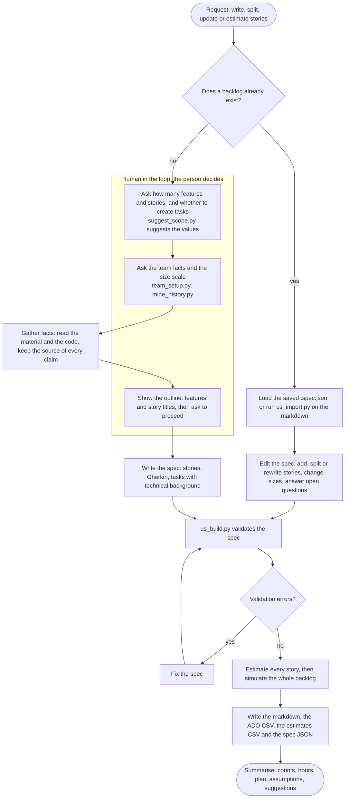
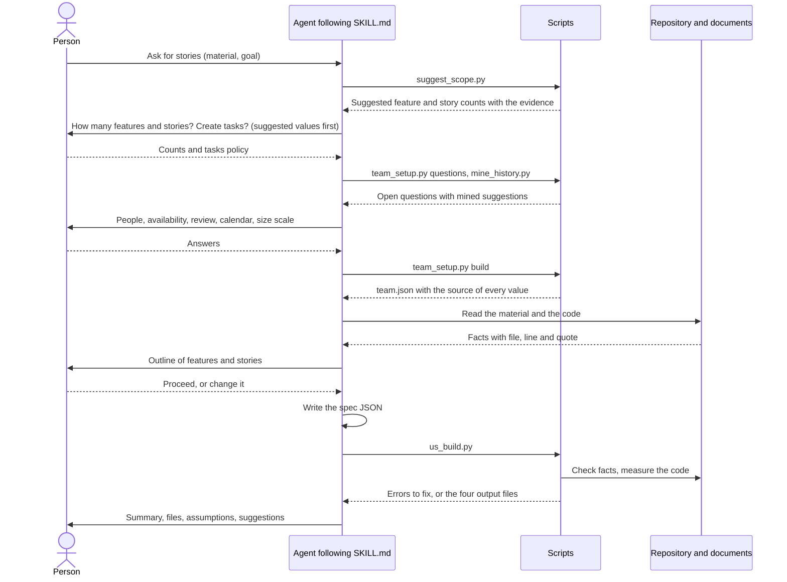
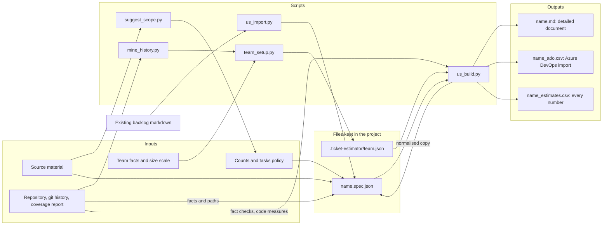
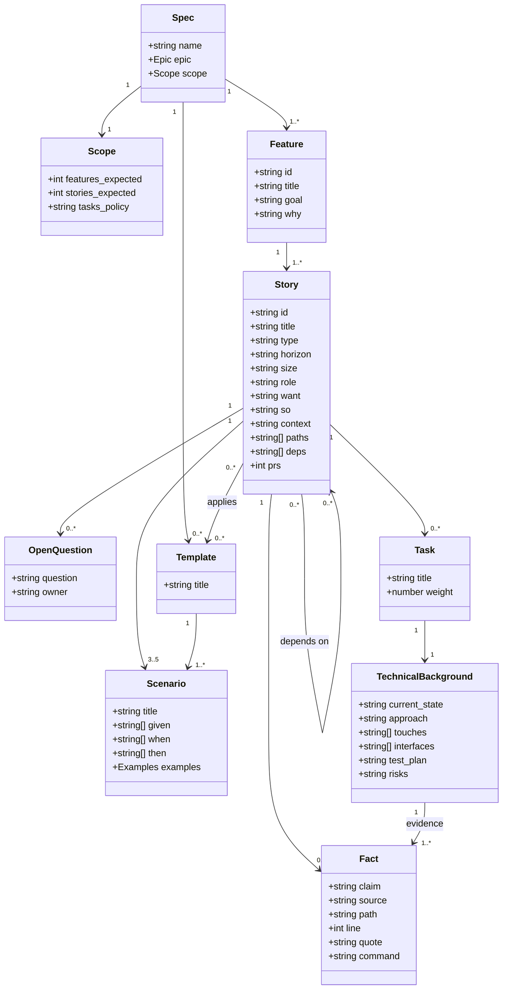
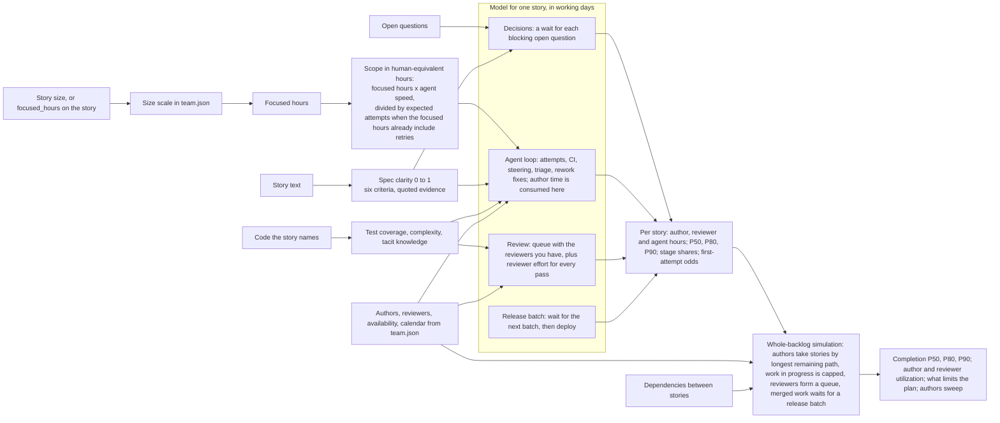
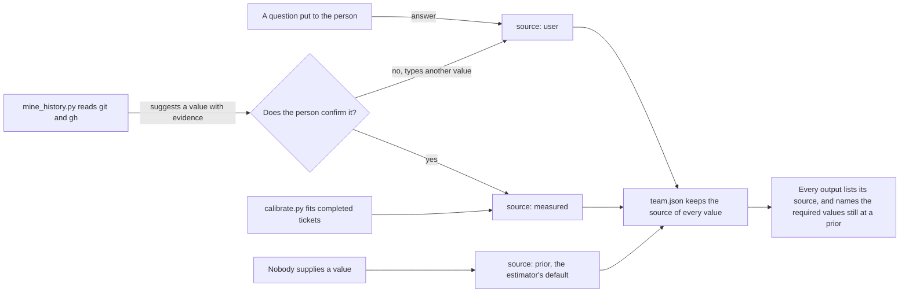
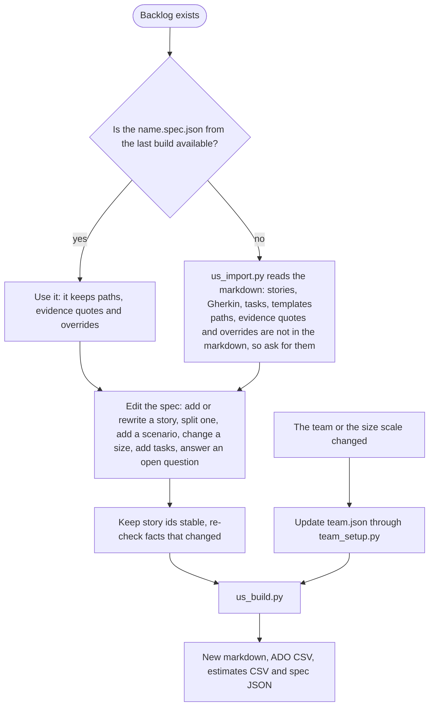

# US-gen-estimate

Write user stories from facts, estimate them with a model of your real team, and export them to Azure DevOps.

An agent skill (for Claude Code and any agent that reads `SKILL.md`) plus a set of plain Python command-line tools. It asks you how big the backlog should be, asks about your team, writes stories in one standard format, checks the facts it cites, forecasts the effort and the lead time of every story and of the whole plan, and writes an Azure DevOps CSV and a detailed markdown. Nothing in it is specific to one project.

## Contents

1. [What it is](#1-what-it-is)
2. [Install and share it](#2-install-and-share-it)
3. [Quick start](#3-quick-start)
4. [How it works](#4-how-it-works)
   - [4.1 The whole process](#41-the-whole-process)
   - [4.2 A session, step by step](#42-a-session-step-by-step)
   - [4.3 Inputs](#43-inputs)
   - [4.4 Data flow](#44-data-flow)
   - [4.5 The story format and the spec](#45-the-story-format-and-the-spec)
   - [4.6 Validation](#46-validation)
   - [4.7 The estimation model](#47-the-estimation-model)
   - [4.8 Where every value comes from](#48-where-every-value-comes-from)
   - [4.9 Updating an existing backlog](#49-updating-an-existing-backlog)
5. [What it assumes](#5-what-it-assumes)
6. [Outputs](#6-outputs)
7. [Using it in other projects and settings](#7-using-it-in-other-projects-and-settings)
8. [Reference](#8-reference)
9. [Troubleshooting](#9-troubleshooting)
10. [Maintaining the skill](#10-maintaining-the-skill)

---

## 1. What it is

| You give it | It does | You get |
| --- | --- | --- |
| Material to write stories from (a document, a brief, a code area) | Suggests how many features and stories, asks you, then writes the stories from facts | Stories as *As a / I want / So that* with 3 to 5 Gherkin scenarios, and tasks with technical background if you want them |
| Facts about your team (people, hours, availability, review, calendar) and a size scale | Estimates every story with a model of that team | Focused hours, author hours, reviewer hours, P50/P80/P90 lead times per story |
| The dependencies between stories | Simulates the whole backlog with your authors and reviewers | A completion range, what limits it, and what changes with more or fewer people |
| Nothing else | Writes four files | `<name>.md`, `<name>_ado.csv`, `<name>_estimates.csv`, `<name>.spec.json` |

Good for planning agent-assisted work (features, refactors, platform and migration work) where the team wants stories written to one standard and estimates tied to real people and calendars. It is not a tracker, it does not replace a planning conversation, and every number it gives is a **forecast range, not a commitment**.

Three rules run through everything:

- **Facts first.** A story states only what the person said or what was read from a file, with a source. File facts are checked against the repository; what nobody has decided becomes an open question with an owner.
- **The person decides the inputs.** Counts, task policy, size scale, team: the skill asks, suggests, records the answer, and labels each value **user**, **measured** or **prior**.
- **Honest about uncertainty.** The output says what is a guess, what is a proxy, and that the model is not calibrated until it has seen your completed tickets.

---

## 2. Install and share it

### Requirements

| Needed | For | Notes |
| --- | --- | --- |
| Python 3 | every script | Tested on 3.11. Every script also parses with the Python 3.8 grammar, but older versions have not been run |
| numpy | the estimator and the simulation | `python -m pip install -r requirements.txt` (needs `numpy.random.default_rng`, numpy 1.17 or later) |
| git | measuring commits, tags, checking paths | optional; without it history mining is skipped |
| GitHub CLI `gh`, logged in | pull-request history in `mine_history.py` | optional; without it only commit history is mined |
| A coverage report | real test coverage instead of a proxy | optional (cobertura XML, lcov, or coverage.py JSON) |

### Install

Copy the `US-gen-estimate/` folder to one of:

- `<your-project>/.claude/skills/US-gen-estimate/` to share it through the project (commit it, so the whole team gets it with a pull)
- `~/.claude/skills/US-gen-estimate/` for yourself, in every project

Then reload skills (`/reload-skills`) or restart the agent. The agent finds Python itself (see [SKILL.md](SKILL.md), Setup), but you can check the install by hand. First find the Python the scripts will use. Run this from the skill folder:

```powershell
# Windows (PowerShell)
powershell -NoProfile -ExecutionPolicy Bypass -File scripts\find_python.ps1
```

```bash
# macOS, Linux or Git Bash
sh scripts/find_python.sh
```

Both print `PYTHON=`, the interpreter to use, and `NUMPY=`. If numpy is missing, run the `INSTALL=` line they print. Then run the self-test with that interpreter, from the skill folder:

```bash
<python> scripts/selftest.py        # prints PASS or FAIL per check, then "all checks passed"
```

`<python>` is the `PYTHON=` path the finder printed, for example `"C:\Program Files\Python311\python.exe"`.

Use it by asking in plain words ("write user stories for this document", "estimate these stories", "update the backlog and re-estimate") or by typing `/us-gen-estimate`.

### Sharing with a team

| Way | How |
| --- | --- |
| Through the repository | Commit `.claude/skills/US-gen-estimate/`. If your `.gitignore` excludes `.claude/`, add an exception such as `!.claude/skills/` |
| Keep private data out | The team's mined history is written to `.ticket-estimator/mined.json` and holds GitHub logins and git names. Add `.ticket-estimator/mined.json` to the project's `.gitignore`. Commit `.ticket-estimator/team.json` instead |
| As a zip | `zip -r US-gen-estimate.zip US-gen-estimate -x "*/__pycache__/*"` (PowerShell: `Compress-Archive -Path US-gen-estimate -DestinationPath US-gen-estimate.zip`) and unzip into `.claude/skills/` |
| Per person | Each person copies the folder to `~/.claude/skills/` |

The team file `.ticket-estimator/team.json` is **project data**, not part of the skill: it holds one team's answers. Commit it if the team shares one set of facts, or keep one per team and pass it with `--team`. See [section 7](#7-using-it-in-other-projects-and-settings).

### Other agents and plain command line

`SKILL.md` is the instruction file the agent follows. Every script is an ordinary command-line tool, so you can run the whole pipeline by hand (see [section 8](#8-reference)). Nothing is sent over a network except what `gh` itself does in `mine_history.py`; the scripts read your files and write the output folder you name.

### Layout

```text
US-gen-estimate/
  SKILL.md                      instructions the agent follows
  README.md                     this file
  requirements.txt              Python packages (numpy)
  VERSION                       1.0.0
  .gitignore                    bytecode caches
  scripts/
    find_python.ps1             find Python and numpy on Windows (PowerShell)
    find_python.sh              find Python and numpy on macOS, Linux and Git Bash
    python_probe.py             the check the two finders run with each interpreter
    suggest_scope.py            suggest how many features and stories
    team_setup.py               ask the team questions, write team.json with provenance
    mine_history.py             measure what git and gh can tell
    us_spec.py                  spec schema, validation, fact checks, spec-clarity scoring, Gherkin
    us_build.py                 validate, estimate, simulate, write the four outputs
    us_import.py                turn a backlog markdown back into a spec (update mode)
    estimate.py                 the model for one ticket
    plan.py                     whole-backlog simulation
    calibrate.py                fit the model to completed tickets
    codebase_features.py        measure coverage, complexity, documentation for some paths
    selftest.py                 checks for all of the above
  references/
    story_format.md             the story format, Gherkin rules, task technical background, ADO columns
    rubric.md                   how the ticket inputs are scored
  assets/
    team_questions.json         the questions asked to the team
    size_scales.json            size-scale presets
    ticket.example.json         input format of estimate.py
    example/                    a small project and a worked spec that validates against it
```

---

## 3. Quick start

```bash
# 1. From the skill folder, build the worked example against its own small project
#    (no team file: every team value is a prior). <python> is the PYTHON= value from the finder.
<python> scripts/us_build.py --spec assets/example/spec.json --repo assets/example/repo --out-dir out

# 2. Look at the four files in out/
#    cache-port-example.md  cache-port-example_ado.csv  cache-port-example_estimates.csv  cache-port-example.spec.json
```

The example is a fictional shop app that puts caching behind a port: 2 features, 4 stories, 12 scenarios, 2 tasks. Its facts point at the files in `assets/example/repo`, so they verify on any machine. Real output of that run (with the estimator's default priors, so your own numbers will differ):

```text
Size: 2 features, 4 stories, 12 Gherkin scenarios, 2 tasks (you expected 2 features and about 4 stories).
Hours: focused 13.0 h (the sizes), author effort 20.1 h (the model), reviewer effort 14.5 h, agent run time 14.7 h.
Median story: lead time P50 4.3, P80 6.4, P90 8.0 calendar days from ready to deployed.
Whole backlog with 2 authors: finishes in P50 18, P80 23, P90 26 calendar days (3.3 weeks at P80).
```

For your own project, just ask the agent for stories; it runs the process in [4.2](#42-a-session-step-by-step) and asks you the questions.

---

## 4. How it works

### 4.1 The whole process



### 4.2 A session, step by step



The person is asked at four points; the agent never answers these for them:

| Checkpoint | Question | What is recorded |
| --- | --- | --- |
| Scope | How many features and stories do you expect? Should tasks be created (every story, only large ones, none)? | `scope.features_expected`, `scope.stories_expected`, `scope.tasks_policy` in the spec |
| Team | Authors, hours per day, availability, reviewers and their time, days per week, how much of an agent run an author must attend, release interval, decision latency | `team.json`, with `source: user` or `measured` per value |
| Sizing | Which size scale (S/M/L/XL in focused hours)? Do those hours already include retries? Typical pull-request size? | `size_scale`, `focused_includes_retries`, `typical_pr_lines` in `team.json` |
| Outline | Here are the features and story titles: proceed or change? (especially above about 20 stories) | the agreed story list |

### 4.3 Inputs

| Input | Provided by | How it is asked or found | Stored in | Used for |
| --- | --- | --- | --- | --- |
| Source material (requirements, design, brief, code area) | The person | Asked first; a typed brief is saved to a file | `scope.source`, the facts | Suggesting counts, writing stories |
| Number of features and stories, tasks policy | The person | Asked, with suggested values first | `spec.scope` | Shaping the backlog; the build warns when the result is far from the ask |
| Team facts (10 required values) | The person, with mined suggestions | `team_setup.py questions` then `build` | `team.json` | Every estimate |
| Size scale, retries flag, typical PR size | The person | `team_setup.py questions --stories` | `team.json` | Focused hours and diff size |
| Facts about the current system | Files and documents | Read, Grep, commands; each kept with its source | `story.facts`, `task.technical_background.evidence` | Context and technical background; verified by the build |
| Open questions | The person | Anything undecided is recorded, never guessed | `story.open_questions` | Decision waits in the estimate, "design decided" score |
| Code a story touches | The agent from the facts | `story.paths` | the spec | Measuring test coverage, complexity, documentation |
| Dependencies between stories | The person and the agent | `story.deps` | the spec | Whole-backlog simulation, critical path |
| Optional: coverage report, history of completed tickets | The team | `codebase_features.py --coverage`, `calibrate.py` | measured values | Replace proxies and priors with measurements |

The ten required team values: `authors`, `author_hours_per_day`, `author_availability`, `reviewers`, `reviewer_hours_per_day`, `reviewer_availability`, `days_per_week`, `agent_attended_fraction`, `release_interval_days`, `decision_latency_days`. Each has a question, a reason it matters and suggested choices in `assets/team_questions.json`.

### 4.4 Data flow



### 4.5 The story format and the spec

Every story has the same shape (details and rules in `references/story_format.md`):

> **As** a release manager landing a long-lived branch, **I want** an ordered ladder of merge-commit pull requests, **so that** every piece reaches the main branch in a reviewable step.

```gherkin
Scenario: A difference blocks the change
  Given a port whose set returns `None` when the cache is enabled
  When the behaviour test runs
  Then it fails and names the call
  And the pull request cannot merge
```

- **3 to 5 Gherkin scenarios per story.** Outcomes must be checkable; at least one scenario should describe a failure, refusal or rollback; a `Scenario Outline` with an `examples` table is supported.
- **Tasks only if the person wants them**, and every task carries a **technical background**: current state, evidence, approach, touched paths, interfaces, test plan, risks. A task's hours are the story's hours split by its weight.
- **Shared scenario templates** (for example "every code move needs the same proof") are written once and attached to stories.

The spec is one JSON file; `us_spec.py` documents it field by field.



### 4.6 Validation

`us_build.py` validates before it estimates. **Errors** stop the build (nothing is written unless you pass `--allow-errors`); **warnings** are listed in the markdown.

| Check | Severity |
| --- | --- |
| A story has fewer than 3 or more than 5 scenarios | error |
| A scenario lacks a title, a `given`, a `when` or a `then`; an `examples` table has ragged rows | error |
| A story lacks a role, want, so, title or type, has no size or `focused_hours`, or names a feature that does not exist | error |
| Placeholder text (`TBD`, `TODO`, `XXX`, `lorem ipsum`, `to be decided`, `???`) anywhere in a story or task | error |
| Unknown dependency, self-dependency, dependency cycle, unknown template | error |
| A fact with a `path` whose file does not exist, or whose `quote` is not in the file | error |
| `tasks_policy` is `all`, or `large` for an L or XL story, and the story has no tasks | error |
| A task lacks `current_state`, `approach`, `touches`, `test_plan` or `risks`, or has no evidence | error |
| A task's `touches` names a path that does not exist (a file to create is written `new:path`) | error |
| No scenario describes a failure, refusal or rollback | warning |
| The context contains numbers but the story lists no facts | warning |
| A story's `paths` do not exist, so code measures fall back to assumed values | warning |
| Size XL ("split it at planning"); more than 15 stories in one feature | warning |
| The spec is far from the counts the person asked for | warning |
| A fact rests on a command or a document the tool cannot re-run | listed under "Not verified" |

### 4.7 The estimation model

For each story the build computes the focused hours, scores the inputs, and runs the model. All durations are converted into the team's **working day** so nothing mixes wall-clock hours with working hours.



**From size to hours.** *Focused hours* are the hours one person works with the agent from starting the branch to a pull request ready for review, with no waiting; they come from the size scale (or `focused_hours` on the story). *Author hours* are what the model says the author spends: the attended part of agent runs, steering, triage of failed attempts and rework fixes. *Reviewer hours* and *agent run hours* come from the same model.

**The stages** (all in working days; the first three use the team's availability and calendar):

| Stage | What it models |
| --- | --- |
| Decisions | Each open question blocks the story with a probability that falls as spec clarity rises; each block waits `decision_latency_days`. Decision owners are not the authors, so this wait uses no author time. |
| Agent loop | Attempts are geometric, with a first-attempt success probability from clarity, test coverage, complexity and tacit knowledge. Each attempt runs the agent (scope / agent speed), CI, and the author's steering; failed attempts add triage; after `max_agent_attempts` a person takes over. The author is present for `agent_attended_fraction` of the run. |
| Review | An M/M/c queue (Erlang C) with `reviewers` servers. Arrivals come from the number of authors, so more authors without more review capacity makes the queue unstable (the model then gives no lead time and says so). Each pass costs reviewer effort (changed lines / lines per reviewer hour); rework passes cost author time. Zero reviewers means PRs merge without independent review. |
| Release | Uniform wait of up to `release_interval_days` for the next batch, plus deploy time. |

**Spec clarity** is scored by rules over the story, conservatively, each criterion 1, 0.5 or 0, with the quoted text behind it printed under every story:

| Criterion | 1 | 0.5 | 0 |
| --- | --- | --- | --- |
| Acceptance criteria | 3 or more scenarios, at least 60% of outcomes checkable | some scenarios | none |
| Edge cases and errors | two or more scenarios describe a failure | one | none |
| Concrete example | an `examples` table | a code span in both a `when` and a `then` | none |
| Scope and dependencies | `paths` or named modules | neither | |
| Design decided | an approach or `design` is written, no open questions | none recorded | open questions, or the story's job is to decide (type SPIKE, DOC, DECISION) |
| Non-functional constraints | parity, security, rollback, performance, compatibility and similar stated in the story | only the shared definition of done | |

A story can override a score with a written reason (`ticket_overrides`), recorded as source `user`.

**Code measures** (`codebase_features.py`) for the paths a story names: test coverage (measured when a coverage report is given, otherwise a proxy: the share of source files with a matching test file), complexity (branch keywords per 100 lines) and tacit knowledge (how rarely the module is mentioned in documentation). A story with no existing paths gets 0.5 for each, flagged as assumed.

**The whole-backlog simulation** (`plan.py`) runs several hundred replications. In each, every story's outcome is drawn from the same distributions as the single-story model; authors pick ready stories by longest remaining path; each author serves one story's human effort at a time; at most `authors x parallel_sessions` stories are between "author starts" and "PR opened"; merged stories wait for the next release batch; dependencies release when the work merges (`--dep-gate release` waits for the release). It reports completion P50/P80/P90, utilization, three lower bounds (critical path, author capacity, reviewer capacity) and what limits the plan, and the build repeats it for a sweep such as `authors=1,2,3,4,6`.

**Levers and sensitivity.** The markdown ranks what-if changes (split the story, add a reviewer, protect availability, release more often, and so on) by their effect on the P80, and ranks the parameters still at a prior by how far they move it, so you can see which guess matters. `agent_speed` is left out of the ranking because it is paired with every story's scope.

### 4.8 Where every value comes from



A mined value is only a suggestion until the person confirms it. If the person cannot answer a required question, `"prior"` is recorded only when they say so, and every output then carries the warning. `estimate.py --require-complete` refuses to forecast while a required value is a prior.

### 4.9 Updating an existing backlog



---

## 5. What it assumes

Read this before you rely on a number.

### 5.1 About the process

- The person's answers are taken as given; the skill does not argue with a size, a team fact or a count. It records them with their source.
- Stories and tasks describe work for **people working with an agent**. Focused hours, steering time and attended agent runs mean nothing for work done without one; use the `human_only` size scale if you want to see that reading.
- A story is one ticket going through one review queue and one release batch. A story that is really several pull requests in sequence is understated on waiting; the `prs` field raises its diff size, not its number of queue passes.
- Story ids and dependencies are the person's; the dependency graph is trusted and checked only for unknown ids and cycles.

### 5.2 About the estimate (the model)

- **Not calibrated.** The coefficients that decide first-attempt success and rework are priors until `calibrate.py` has run on completed tickets (30 or more, about 100 for stable estimates).
- Stages are sampled independently, although a vague story causes both rework and slow review in real life.
- Review is a queue with exponential service times; real review times vary more.
- People are interchangeable within a role; authors and reviewers are separate pools (a reviewer who also authors is not modelled).
- No ramp-up, holidays beyond the availability factor, context-switching cost, or rework that spans several stories.
- The simulation schedules by longest remaining path and counts a decision wait from the moment a story's dependencies finish; real teams reorder work and ask earlier.
- Lead time means *ready to deployed*, including waiting; effort hours are work, and only effort hours add up across stories.

### 5.3 The defaults ("priors") used when nobody supplies a value

These are the estimator's defaults, read from `estimate.py`. They are guesses, not measurements, and each output names the ones in use.

| Parameter | Default | Meaning |
| --- | --- | --- |
| `authors` | 2 | People producing pull requests with an agent |
| `author_hours_per_day` | 6.0 | Focused hours per working day |
| `author_availability` | 0.8 | Share of those hours free for this backlog |
| `reviewers` | 2 | People who review (0 means PRs merge unreviewed) |
| `reviewer_hours_per_day` / `reviewer_availability` | 6.0 / 0.3 | A reviewer's day and the share spent reviewing |
| `days_per_week` | 5 | Working days per week |
| `agent_attended_fraction` | 1.0 | Share of an agent run the author must stay for |
| `release_interval_days` | 1.0 | Working days between release batches (0 = every merge deploys) |
| `decision_latency_days` | 1.0 | Working days a blocking decision waits |
| `lines_per_reviewer_hour` | 200 | Changed lines a reviewer gets through per hour |
| `mean_pr_lines` / `typical_pr_lines` | 300 / 400 | Mean PR size for the queue, and a story's PRs-to-lines factor |
| `agent_speed` | 4.0 | Human-equivalent hours the agent completes per hour it runs |
| `steer_h` / `triage_h` / `rework_fix_h` | 0.25 / 0.5 / 0.5 | Author hours per attempt, per failed attempt, per rework pass |
| `ci_hours` / `deploy_h` | 0.25 / 0.5 | Verification time per attempt; deploy time |
| `max_agent_attempts` | 5 | Attempts before a person takes over |
| `parallel_sessions` | 3 | Stories an author can keep in flight (simulation only) |
| `size_scale` | S 1, M 3, L 8, XL 16 | Focused hours per size |
| `focused_includes_retries` | 1 | The focused hours already contain retries and steering |
| `b0`, `b_clarity`, `b_tests`, `b_complex`, `b_tacit` | -0.5, 2.0, 1.5, 1.2, 1.0 | First-attempt success model |
| `r0`, `r_size`, `r_tests`, `r_clarity` | -1.5, 1.0, 1.5, 1.0 | Rework probability model |

### 5.4 Judgement inputs and proxies

| Input | What it really is |
| --- | --- |
| Size and the size scale | The person's judgement; the presets are starting points from one team's agent-assisted work, not a measurement of yours |
| Spec clarity | Rules over the story text; biased when the person who writes the story also scores it, so audit a sample against `references/rubric.md` |
| Test coverage | A proxy (share of source files with a matching test file) unless a coverage report is supplied |
| Complexity, tacit knowledge | Always proxies |
| Diff size | `prs x typical_pr_lines` unless the story gives its own |
| Mined team values | Describe the people and pull requests found, not necessarily your team; the person confirms them |

### 5.5 How to reduce the assumption

1. Answer the required team questions yourself; do not accept priors.
2. Name the code each story touches (`paths`) so coverage and complexity are measured.
3. Pass a real coverage report to `codebase_features.py`.
4. Record completed stories with their real lead times and run `calibrate.py` (with `--base team.json`). Trust the out-of-sample backtest; the in-sample one flatters the model.
5. Re-run after the first stories close and compare the plan's range with what happened.

---

## 6. Outputs

| File | What it is |
| --- | --- |
| `<name>.md` | The detailed document (below) |
| `<name>_ado.csv` | An Azure DevOps import file with standard columns only |
| `<name>_estimates.csv` | Every number per story and task, for spreadsheets and other trackers |
| `<name>.spec.json` | The normalised spec: the source of truth for the next update |

### 6.1 The markdown

| Section | Content |
| --- | --- |
| 1. Summary | Counts against what you asked for; focused, author, reviewer and agent hours; median story lead time; whole-backlog completion; validation status |
| 2. Inputs and where they came from | Every team parameter with its source, the size scale, and the assumptions that apply |
| 3. Features at a glance | Per feature: stories, focused and author hours, median P50/P80/P90 |
| 4. Estimates for every story | One table: hours, P50/P80/P90 in working days and in calendar days, where the time goes (authors and agent, review, release, decisions), first-attempt and rework odds, the main wait |
| 5. The whole backlog | Completion P50/P80/P90, what limits it, lower bounds, the authors sweep |
| 6. Suggestions from the model | Levers by effect on the P80, parameters at a prior by effect on the P80, and plain suggestions |
| 7. Stories | Per story: the user story, estimate table (P50/P80/P90 in working days, calendar days and wall hours), inputs, spec-clarity breakdown with quotes, open questions, context, facts with verification status, Gherkin, tasks with technical background and hours |
| 8. Open questions, validation, not verified | Open questions with owners, validation warnings, facts checked and facts the tool could not verify |
| Appendix | Shared scenario templates |

A story as it appears in section 7 (real output of the worked example, priors only):

```text
#### S1.2. Prove the cache behaves the same behind the port

> As an operator deploying a new version, I want a behaviour test that makes the same calls on
> the old functions and on the port, so that a deploy never changes what a cached page returns.

| Estimate                    | Value                                                                           |
| Size / focused hours        | S . 1.0 h (default scale)                                                       |
| Author effort               | 2.1 h                                                                           |
| Reviewer effort             | 2.26 h                                                                          |
| Lead time P50 / P80 / P90   | 2.5 / 3.8 / 4.8 working days . 3.5 / 5.3 / 6.7 calendar days . 84 / 127 / 161 wall hours |
| Where the time goes         | authors and agent 15% . review 68% . release batch 17% . decisions 0%           |
```

### 6.2 The Azure DevOps CSV

Epic in `Title 1`, feature in `Title 2`, story in `Title 3`, task in `Title 4`. Columns are standard fields only, so the file imports without "field does not exist" errors:

`Work Item Type, Title 1, Title 2, Title 3, Title 4, Description, Acceptance Criteria, [story effort field], [task hour fields], Tags`

- **Description** holds the user story, context, facts, estimate and dependencies (a task's holds its technical background); **Acceptance Criteria** holds the Gherkin in a `<pre>` block. Text is HTML; use `--plain-text` for plain text.
- **Process.** `--ado-process` picks the work-item type and the fields:

| Process | Story type | Story effort field | Task hour fields | Acceptance Criteria field |
| --- | --- | --- | --- | --- |
| `agile` (default) | User Story | none (Story Points are not hours, so the hours go in the Description) | Original Estimate, Remaining Work | yes |
| `scrum` | Product Backlog Item | Effort (the story's author hours) | Remaining Work | yes |
| `cmmi` | Requirement | Size (the story's author hours) | Original Estimate, Remaining Work | yes |
| `basic` | Issue | Effort | Remaining Work | no (the Gherkin is appended to the Description) |

- Override with `--story-effort-field FIELD` (`''` omits it) and `--task-fields "A,B"`. Field names differ between processes and customised projects: check them against yours.
- `--extra-columns` adds non-ADO analysis columns (focused, author and reviewer hours, lead times). Remove them before importing into a project that rejects unknown fields.
- A task's hours are the story's author hours split by the task's `weight`; the last task takes the rounding remainder.
- **To import** (per [Microsoft's CSV import guide](https://learn.microsoft.com/en-us/azure/devops/boards/queries/import-work-items-from-csv)): in the project's web portal go to **Boards → Queries → Import work items**, choose the file, select **Import**, check the unsaved items, then **Save items**. The title columns (`Title 1` to `Title 4`) create the parent-child links. Azure DevOps imports at most **1,000 work items per file** (the build warns when the file is larger), sets every new item's State to New, and leaves out ID, Assigned To, State and the date fields (this file has none of them).
- The structure of the file is checked by the self-test, but the skill has not been run against every ADO process or customisation: do a trial import into a scratch project first.

### 6.3 The estimates CSV

One row per story and task: `id, kind, feature, title, type, size, horizon, focused_h, author_h, reviewer_h, agent_run_h`, `P50/P80/P90` in working days, calendar days and wall hours, the four stage shares, `bottleneck, p_first_attempt, rework_probability, spec_clarity, clarity_source, open_questions, test_coverage, test_coverage_source, complexity, tacit, prs, diff_lines, scope_hours_human_equivalent`, and the story's finish time in the whole-backlog simulation (`plan_finish_P50_calendar_days`, `plan_finish_P80_calendar_days`).

### 6.4 The spec JSON

The normalised input. Re-running `us_build.py` on it reproduces the other three files; editing it is how a backlog is updated.

---

## 7. Using it in other projects and settings

| Situation | What to do |
| --- | --- |
| A different Azure DevOps process or a customised one | `--ado-process` plus `--story-effort-field` and `--task-fields`; do a trial import |
| Jira, GitHub Issues, Linear, a spreadsheet | Use `<name>_estimates.csv` and `<name>.spec.json` (stories, Gherkin, hours, dependencies). There is no importer for these trackers; map the columns you need |
| Not a git project, or no GitHub | Skip `mine_history.py` (answer the team questions yourself); give `--repo` any folder that holds the files your facts cite, or use `--skip-fact-check` |
| A monorepo or several teams | Keep one `team.json` per team and pass it with `--team`; `paths` are relative to `--repo` |
| Other languages | The code measures read common source extensions (Python, JS/TS, Go, Java, Kotlin, Ruby, Rust, C#, PHP, C and C++ and others); a coverage report in cobertura, lcov or coverage.py form gives real coverage |
| Different story types or horizons | `type` and `horizon` are free text. A type can have its own size scale (`by_type`) and its own shared scenarios (`templates`) |
| No tasks wanted | Answer "no tasks" at the scope question (`tasks_policy: none`) |
| A very large backlog | The 77-story backlog used to test it builds in about ten seconds; `--reps`, `--n`, `--no-levers` and `--no-sensitivity` trade accuracy for speed |
| A team that shares its team file | Commit `.ticket-estimator/team.json`; each person can still override a value through `team_setup.py` |
| Work without an agent | Choose the `human_only` size scale and answer `agent_attended_fraction` and the review questions accordingly |
| Privacy | The scripts run locally and send nothing anywhere; the agent sees whatever files it reads |

---

## 8. Reference

### 8.1 Scripts

| Script | Purpose | Key options |
| --- | --- | --- |
| `suggest_scope.py` | Suggest feature and story counts from material, an existing backlog, or defaults | `--source FILE...`, `--text "brief"`, `--spec FILE`, `--md FILE` |
| `team_setup.py` | `questions` lists what is still to ask; `build` writes `team.json`; `show` prints it | `questions --mined M --existing T --stories`; `build --answers A --mined M --existing T --accept-mined-optional --out T` |
| `mine_history.py` | Measure authors, PR rate and size, reviews, CI time, focused hours, release cadence | `--repo`, `--since-days`, `--people`, `--git-names`, `--base`, `--out` |
| `us_build.py` | Validate, estimate, simulate and write the four outputs | `--spec`, `--team`, `--repo`, `--out-dir`, `--name`, `--ado-process`, `--story-effort-field`, `--task-fields`, `--extra-columns`, `--plain-text`, `--reps`, `--n`, `--seed`, `--sweep KEY=V1,V2`, `--no-sweep`, `--no-levers`, `--no-sensitivity`, `--skip-fact-check`, `--allow-errors` |
| `us_import.py` | Turn a backlog markdown in this format back into a spec | `--md`, `--out`, `--name`, `--tasks-policy all/large/none` |
| `estimate.py` | Forecast one ticket | `--ticket`, `--team`, `--n`, `--seed`, `--levers`, `--sensitivity`, `--require-complete` |
| `plan.py` | Simulate a backlog from a JSON of stories and dependencies | `--backlog`, `--team`, `--reps`, `--set KEY=V`, `--sweep KEY=V1,V2`, `--dep-gate merge/release` |
| `calibrate.py` | Fit the model to completed tickets and run in-sample and out-of-sample backtests | `history.csv`, `--out`, `--base`, `--set KEY=V` |
| `codebase_features.py` | Measure coverage, complexity, documentation for some paths | `--repo`, `--paths`, `--coverage` |
| `selftest.py` | Checks for everything above | none |

### 8.2 `team.json`

A flat JSON file written by `team_setup.py`. Besides the values it holds:

- `provenance`: for each parameter, `{"source": "user" | "measured" | "prior", ...}` with the evidence for measured values
- `complete`: true when no required value is a prior; `required_at_prior`: the list that still is
- `calibrated`: true only after `calibrate.py`
- `size_scale`: `{"default": {"S", "M", "L", "XL"}, "by_type": {"TYPE": {...}}, "preset": "name"}`

Sections: people and calendar (the ten required values plus `parallel_sessions`), workflow (`mean_author_hours_per_pr`, `pr_arrivals_per_day`, `steer_h`, `agent_speed`, `ci_hours`, `triage_h`, `max_agent_attempts`, `rework_fix_h`), review (`lines_per_reviewer_hour`, `mean_pr_lines`), release (`deploy_h`), sizing (`size_scale`, `focused_includes_retries`, `typical_pr_lines`), and the success and rework coefficients.

### 8.3 `answers.json`

What `team_setup.py build` reads: `{key: number | "mined" | "prior"}`. `"mined"` accepts the mined suggestion (recorded as measured and confirmed by a person); `"prior"` keeps the default and says so. `size_scale` accepts a preset name (`agent_assisted`, `agent_assisted_refactor`, `conservative`, `human_only`) or a table.

### 8.4 The spec

Top level: `schema`, `name`, `epic {id, title, goal, exit_criteria}`, `scope {features_expected, stories_expected, tasks_policy, source}`, `templates {NAME: {title, scenarios}}`, `features [...]`, `stories [...]`. A story has `id, feature, title, type, horizon, size | focused_hours, role, want, so, context, facts, scenarios, templates, deps, open_questions, paths, prs, diff_lines, ticket_overrides, design, tasks`. The full field list with an example is in the docstring of `scripts/us_spec.py`, and a complete worked spec is `assets/example/spec.json`.

---

## 9. Troubleshooting

| Symptom | Cause | Fix |
| --- | --- | --- |
| `Python was not found` on Windows, or `python3` opens the Microsoft Store | `python` and `python3` can be the Store alias, which is not a real interpreter | Run `find_python.ps1` (Windows) or `find_python.sh`. They skip the alias and print the real interpreter. To use a specific one, pass it: `find_python.ps1 -Python "C:\...\python.exe"` or `find_python.sh /path/to/python` |
| `No module named numpy` | numpy is not installed for that interpreter | `<python> -m pip install -r requirements.txt` (the `INSTALL=` line from the finder) |
| `pip` refuses with `externally-managed-environment` | Homebrew or Debian Python protects its system packages | Create a virtual environment (`python3 -m venv ~/.venvs/us-gen-estimate`), install into it, and pass its interpreter to the finder |
| `N validation error(s); nothing written` | The spec breaks a rule in [4.6](#46-validation) | Fix each listed item and rebuild; `--allow-errors` writes the files anyway (the errors are listed in the markdown) |
| `fact failed: the quoted text does not appear in <file>` | The file changed, or the quote was paraphrased | Quote the file's exact text, or drop the `quote` and keep `path` and `line` |
| `evidence path not found in the repository` | `--repo` points at the wrong folder | Paths are relative to `--repo`; fix the path or the folder |
| `Review queue is unstable` / lead times show `n/a` | The authors open pull requests faster than the reviewers can clear them | Add reviewer time or reviewers, or fewer authors; the build still gives effort hours and the whole-backlog result |
| Lots of "assumed at 0.5" notes | Stories name no existing code | Add `paths` for the code each story touches |
| Many "prior" labels | The team questions were not answered | Run the team questions; do not accept priors silently |
| `mine_history.py` describes the whole repository, not the team | No filter was given | Pass `--people` and `--git-names` for the people on this work |
| `gh` errors in `mine_history.py` | `gh` is missing or not logged in | `gh auth login`; without it only commit history is mined |
| ADO import rejects a column | Your process or customisation lacks that field | Change `--ado-process`, `--story-effort-field`, `--task-fields`, or remove `--extra-columns` |
| ADO import stops at 1,000 items | Azure DevOps accepts at most 1,000 work items per CSV | Split the backlog by feature into several files |
| Numbers differ from a colleague's | Different team file, size scale or seed | Compare `team.json`; use the same `--seed` for repeatable results |

---

## 10. Maintaining the skill

- **Verify** after any change: `<python> scripts/selftest.py` (the `PYTHON=` value from the finder).
- **Paths.** Skill files are found from the scripts' own location, and the agent gets the skill folder from the finder's `SKILL_DIR=` line. Project files are relative to the folder the agent runs from, which must be the project root. Keep it that way when you add a script: read assets with `os.path.dirname(os.path.abspath(__file__))`, never a bare relative path.
- **Version.** Bump `VERSION` and add a changelog row for every change the team will receive. It checks the model against known values, the validation rules, fact checking, the size scale, a full build of the example, the ADO file structure, the markdown import round trip, and the scope suggestion.
- **Do not edit scripts to change a result**; change the inputs or recalibrate. Improving the skill itself is a separate task.
- The scripts avoid writing `__pycache__` into the skill folder; if you find one, delete it before sharing.
- **Diagrams** in this file are Mermaid; GitHub, GitLab, VS Code (with a Mermaid extension) and most documentation tools render them.

Changelog

| Date | Change |
| --- | --- |
| 2026-10-19 | Forecast model rebuilt around people and calendars: authors, reviewers, availability, working days, review queue; human-in-the-loop team questions with provenance; history mining; whole-backlog simulation; out-of-sample calibration |
| 2026-10-20 | Story generation and updating in the standard format; ADO CSV and detailed markdown; scope suggestions; size scales; renamed from `ticket-lead-time` to `US-gen-estimate`; portable example |
| 2026-10-20 | 1.0.0, first team release: Python finder for Windows, macOS, Linux and Git Bash; `requirements.txt`; skill paths resolved from the skill folder and project paths relative to the project root; `.gitignore`; `VERSION`; fixed the worked-example path in `SKILL.md`; `mined.json` moved to `.ticket-estimator/` |
